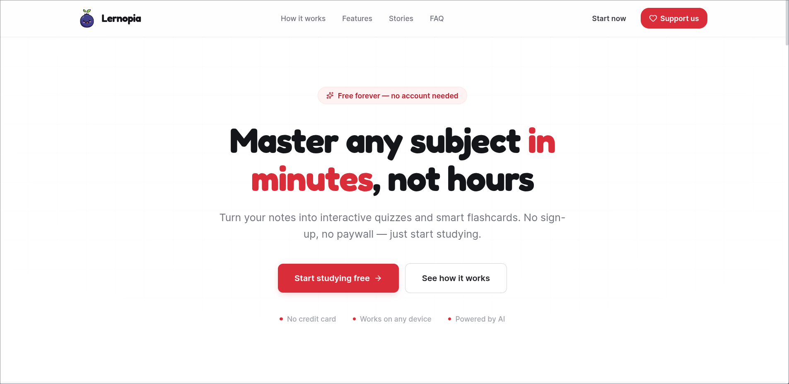
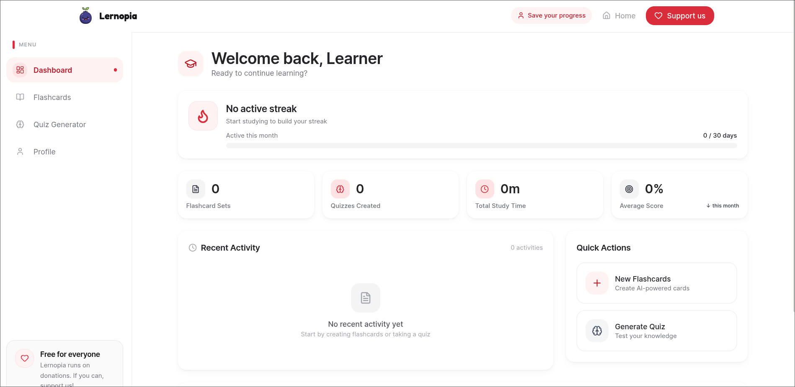
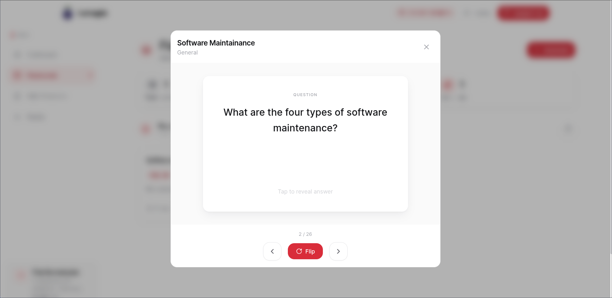
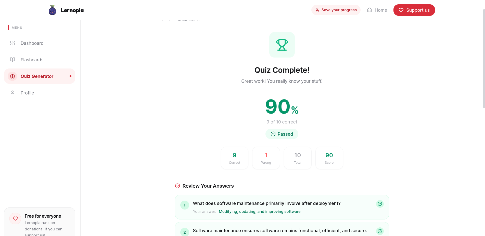
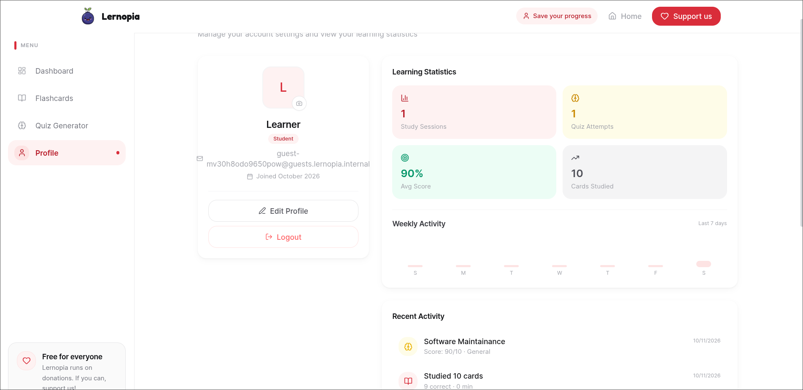
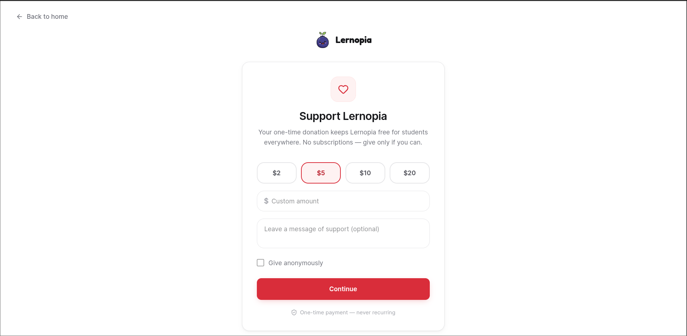

# Sambilila — AI Study Assistant

**Sambilila** (meaning *"Learn"*) is an AI-powered study productivity web app that converts notes into interactive **flashcards and quizzes**.

Built for simplicity and affordability, Sambilila strips learning platforms down to the essentials: generate study material from any text, review it, and track progress. It also supports shared study content, donations, and a companion analytics server.

### Purpose

To empower students — especially in resource-limited environments — with modern, low-cost AI tools that make studying more efficient and accessible.

## Tech Stack

- **Frontend/Backend:** Next.js (React 19) + Tailwind CSS, API routes, Recharts, framer-motion
- **Database:** PostgreSQL + Prisma ORM
- **AI:** Google Gemini API
- **Storage:** Cloudflare R2 (S3-compatible) for file uploads
- **Payments:** PayPal (donations), Lenco (payments)
- **Analytics:** standalone Node/Express analytics server (`analytics-server/`)

## Features

- **AI Flashcard Generator** — convert notes or topics into structured study cards
- **AI Quiz Generator** — create interactive quizzes from any text, with results tracking
- **Study Dashboard** — manage and review saved flashcards and quizzes in one workspace
- **User Authentication** — email/password login plus guest sessions
- **Share & study public content** — public share links for quizzes and flashcard sets
- **Profile & settings** — account details, password change
- **Donations** — PayPal-based donate flow
- **Admin analytics** — admin API with engagement metrics (see `analytics-spec.md`)

## Prerequisites

- Node.js 20+
- PostgreSQL
- API keys: `GEMINI_API_KEY` (AI generation), PayPal and/or Lenco credentials (payments), R2 credentials (file uploads)

## Setup

```bash
npm install          # runs `prisma generate` via postinstall
cp .env.example .env # then fill in values
npm run db:push      # apply Prisma schema to the database
npm run db:seed      # optional seed data
npm run dev
```

Visit `http://localhost:3000`.

The essential variables are listed in [`.env.example`](.env.example) — the file documents every variable the code actually reads (verified by `scripts/verify-env-example.sh`). The key ones:

```env
DATABASE_URL=postgresql://...      # main app database (Prisma)
JWT_SECRET=<generate-a-strong-secret>
GEMINI_API_KEY=<your-gemini-key>   # AI flashcard/quiz generation
# Payments
PAYPAL_CLIENT_ID=
PAYPAL_CLIENT_SECRET=
LENCO_API_BASE=                    # payment API base URL
LENCO_API_KEY=
# Storage (quiz/flashcard file uploads)
R2_ENDPOINT_URL=
R2_ACCESS_KEY_ID=
R2_SECRET_ACCESS_KEY=
R2_BUCKET_NAME=
```

### Analytics server

```bash
cd analytics-server
npm install
JWT_SECRET=<shared-with-main-app> node src/index.js
```

### Production build

```bash
npm run build
npm start
```

## Screenshots

> Placeholders — add actual captures to `docs/screenshots/`.


*Landing page*


*Dashboard — study workspace*


*Flashcards — AI-generated study cards*


*Quiz Results — score and review*


*Profile — account settings and password change*


*Donate — PayPal donation flow*
